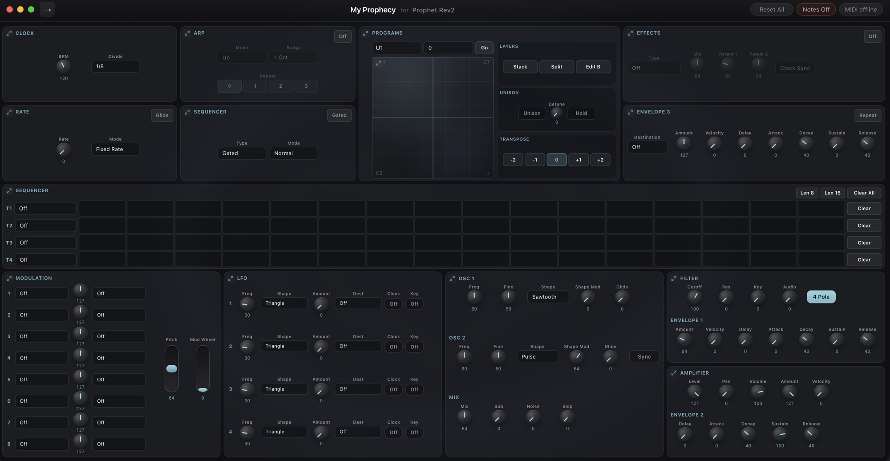

# My Prophecy

A free, open-source web editor for the **Sequential Prophet Rev2** — the whole front panel on one
screen, plus patch browsing, audio-to-MIDI transcription and save / load, talking to the synth over
Web MIDI (e.g. a MidiLink Mini or any class-compliant USB MIDI interface).



[](https://www.buymeacoffee.com/pisaqenn)

**Open source** under the [MIT License](LICENSE) — use it, change it, share it. Contributions welcome.

**MIDI map:** in-app **MIDI Docs**, or [docs/midi-reference.md](docs/midi-reference.md).

> **Safari users:** Safari has no built-in Web MIDI. Install the free
> [Web MIDI for Safari](https://triglavmodular.hu/mods/safari-webmidi/) extension, enable it, then
> reload the app. Chrome, Edge and Firefox work out of the box.

## Requirements

- macOS
- **Chrome**, **Edge**, or **Firefox** (Web MIDI built in)
- **Safari** (macOS only): install [Web MIDI for Safari](https://triglavmodular.hu/mods/safari-webmidi/) — Safari has no native Web MIDI
- Prophet Rev2 + Midi Interface

## Quick start

```bash
cd my-prophecy
npm install
npm run dev
```

Open the local URL Vite prints (usually `http://localhost:5173`), allow MIDI access when prompted, and pick your MidiLink Mini as **Output** / **Input**.

## Rev2 globals (important)

On the synth, open **Global** and set:

| Setting             | Suggested value                                                 |
| ------------------- | --------------------------------------------------------------- |
| MIDI Param Receive  | **CC** or **NRPN** — must match the Mode in the app sidebar     |
| MIDI Param Send     | Same as Receive if you want knobs on the synth to update the UI |
| MIDI Control Enable | On                                                              |
| MIDI Program Enable | On (for bank/program recall)                                    |
| MIDI Out Select     | MIDI (or MIDI+USB) so the DIN → MidiLink path is live           |
| MIDI Channel        | Match the channel in the app (default 1)                        |

**NRPN** is Sequential’s preferred mode and unlocks LFOs, the mod matrix, unison, sync, poles, etc. **CC** covers most front-panel knobs with a 0–127 range.

## What’s in the editor

- **Panel** — the Rev2 front panel on one screen: oscillators, filter, amp, Env 3, LFOs 1–4,
  mod matrix, effects, arp / clock, gated sequencer, programs, unison, transpose, pitch / mod wheels.
  Every section has an expand icon that opens an enlarged copy.
- **Patches** — record audio previews of a bank, browse by listening, find similar patches, morph between two
- **Audio → MIDI** — transcribe a recording (Spotify Basic Pitch, in the browser), play it on the
  Prophet or in the browser, export `.mid`, or write the melody into a sequencer track (Layer A or B)
- **Save / Load** — both layers to / from JSON
- **MIDI Monitor** and **MIDI Docs**
- Reset All, Notes Off, computer-keyboard playing (Z–M · Q–I, `[` `]` octave)
- Bidirectional CC / NRPN when the synth is transmitting; SysEx edit-buffer dumps for both layers

## Project layout

```
src/
  main.js        entry point
  app/           composition root, shell markup, navigation, MIDI connection, persistence
  components/    reusable UI: controls (knobs, selects…), confirm dialog, trackpad
  panel/         Panel view: board, section builders, controls, section modal, gated sequencer
  pages/         Patches, Audio → MIDI, Save / Load, MIDI Monitor, MIDI Docs
  services/      shared logic: layers documents (save/load/patches), paced MIDI sending
  midi/          Web MIDI engine, Rev2 parameter map, SysEx, computer keyboard
  audio/         transcription (worker + helpers), MIDI file writer
  patches/       patch library (IndexedDB), audio capture, similarity / morph
  lib/           small pure helpers
  fractal/       soft Julia-set background
  styles/        CSS — index.css imports base → layout → components → panel → pages (order = cascade)
tooling/         Vite plugin that starts the trackpad companion during `npm run dev`
scripts/         postinstall: copies the Basic Pitch model into public/models/
```

## Real MacBook trackpad → MIDI

Browsers cannot read absolute trackpad touches, and a **published** site cannot start Mac programs. Mac users run a small **companion** once; the website Enable/Disable button talks to it on `http://127.0.0.1:17321` (CORS open).

1. Start companion (leave it running):
   ```bash
   npm run trackpad:daemon
   ```
   or double-click **`Start Trackpad Companion.command`**
2. Open the site (local **or** published) → **Trackpad** → **Enable real trackpad**
3. **Input** → `my-prophecy Trackpad`, **Output** → MidiLink
4. MIDI Thru forwards notes to the Rev2

Disable in the UI stops capture; quit the companion when finished.

```bash
npm run trackpad                 # capture on immediately
npm run trackpad -- --out MidiLink
```

## Development

Requires **Node 24 LTS** (see `.nvmrc` — run `nvm use` in the project folder).

```bash
npm run dev            # dev server
npm run build          # production build → dist/
npm run preview        # serve the build

npm test               # unit tests (Vitest)
npm run lint           # ESLint + Stylelint
npm run lint:fix       # auto-fix what can be fixed
npm run format         # Prettier
npm run check          # everything: lint, format check, tests, build, npm audit
```

Unit tests live next to the code (`*.test.js`) and cover the MIDI engine, SysEx parsing,
parameter scaling, the layers file format, MIDI-file writing, note clean-up, patch similarity,
the trackpad pitch mapping and companion API, and the Panel's short control labels.

## Deployment

Every push to `main` runs `.github/workflows/ci.yml`: lint, format check, tests, a build with the
GitHub Pages base path (`/<repo>/`) and `npm audit --audit-level=high`. If all pass, `dist/` is
deployed to GitHub Pages. Pull requests run the same checks without deploying.

The site must be served over HTTPS — browsers only expose Web MIDI in a secure context.
